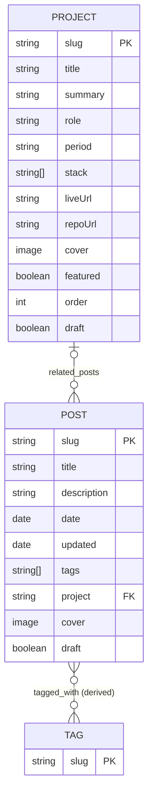

# ERD: Content Model

> **This project has no database.** The "entities" below are content types stored as MDX files in Git and validated by Zod schemas at build time. This document describes their structure and relationships so the AI (and the owner) share one mental model.
>
> Field-level validation rules live in `AGENTS.md` section 6 and are **authoritative**. When a schema changes, update both files.

---

## 1. Diagram

Reading the relationships:

- A **POST** belongs to **zero or one** PROJECT. A PROJECT has **zero or more** POSTs.
- A **POST** has **zero or more** TAGs. A TAG has **one or more** POSTs. TAG is derived, not stored.

---

## 2. Entities

| Entity            | Kind             | Storage                                                   | Primary key                         | Used by                                                                                                       |
| ----------------- | ---------------- | --------------------------------------------------------- | ----------------------------------- | ------------------------------------------------------------------------------------------------------------- |
| `PROJECT`         | Persisted        | `src/content/projects/*.mdx`                              | `slug` (filename without extension) | `/`, `/projects`, `/projects/[slug]`, OG images, sitemap, search                                              |
| `POST`            | Persisted        | `src/content/blog/*.mdx`                                  | `slug` (filename without extension) | `/`, `/blog`, `/blog/[slug]`, tag pages, RSS, OG images, sitemap, search                                      |
| `TAG`             | Derived          | Computed from `POST.tags` at build time                   | tag string                          | `/blog/tag/[tag]`, `TagList`                                                                                  |
| `SITE_CONFIG`     | Singleton config | `src/config/site.ts`                                      | n/a                                 | Layout, SEO, JSON-LD, footer, nav, About page (`bio`, `skills`), robots and sitemap rules (`seo`), llms files |
| `CONTACT_MESSAGE` | Transient        | **Not stored**                                            | n/a                                 | `/api/contact` then email via Resend                                                                          |
| `LLMS_FILES`      | Derived          | Generated at build from POST, PROJECT and SITE_CONFIG     | n/a                                 | `/llms.txt`, `/llms-full.txt`, `/blog/[slug].md`, `/projects/[slug].md`                                       |
| `SITEMAP`         | Derived          | Generated at build from POST, PROJECT, TAG and `site.nav` | n/a                                 | `/sitemap.xml`, `robots.txt`                                                                                  |

---

## 3. Relationships and integrity

| Relationship    | Cardinality  | Implementation                                                | Integrity rule                                                                     |
| --------------- | ------------ | ------------------------------------------------------------- | ---------------------------------------------------------------------------------- |
| PROJECT to POST | 0..1 to 0..* | `post.project` uses Astro's `reference('projects')`, optional | A reference to a non-existent project **fails the build**.                         |
| POST to TAG     | many to many | `post.tags` is `string[]`; tags are derived                   | Tags are normalized to lowercase kebab-case; empty or duplicate tags are rejected. |

**Draft interaction:** a published POST must not reference a draft PROJECT. `getPublishedPosts()` in `src/lib/content.ts` detects this and fails the build with a clear message (otherwise the link would point to a page that does not exist in production). Both integrity rules (missing reference, draft reference) are covered by negative build tests.

---

## 4. Identity and slug rules

- `slug` = filename without extension (e.g. `optimizing-laravel-queues.mdx` gives `optimizing-laravel-queues`).
- Lowercase, kebab-case, ASCII, unique within its collection.
- Slugs are **immutable once published**. If one must change, add a permanent redirect in the `redirects` array of `vercel.json` from the old URL to the new one (URLs have no trailing slash, e.g. `/blog/old-slug` to `/blog/new-slug`).
- Tag slugs follow the same rules. Tag display names are derived from the slug unless a mapping is added later.

---

## 5. Derived data rules

| Value                        | Rule                                                                                                                                                                   |
| ---------------------------- | ---------------------------------------------------------------------------------------------------------------------------------------------------------------------- |
| Reading time                 | `ceil(words / 200)` minutes, computed from the post body                                                                                                               |
| Excerpt                      | `post.description` (no separate excerpt field)                                                                                                                         |
| Previous / next post         | Adjacent published posts ordered by `date` descending                                                                                                                  |
| Tag list                     | Unique tags across **published** posts; a tag page exists only if it has at least one published post                                                                   |
| Featured projects            | `featured: true`, sorted by `order` ascending, max 3 on the homepage                                                                                                   |
| Related posts (on a project) | Published posts whose `project` equals the project's slug, newest first                                                                                                |
| `dateModified` (JSON-LD)     | `post.updated ?? post.date`                                                                                                                                            |
| Canonical URL                | `site.url` + pathname, normalized by `canonicalUrl()` in `src/lib/seo.ts` (no trailing slash, no `.html`, `/` for the home page)                                       |
| Related posts (on a post)    | Other published posts sharing at least one tag, ordered by shared-tag count then newest, max 3                                                                         |
| Indexable tag page           | A tag page is indexable only when the tag has at least `site.seo.minPostsForIndexableTag` (3) published posts; otherwise `noindex, follow` and absent from the sitemap |
| Sitemap `lastmod`            | Post: `updated ?? date`. Home, `/blog`, tag pages: the newest of the posts they show. Projects and static pages: none (no reliable date)                               |
| llms entry                   | One line per published post and project in `/llms.txt`; full text in `/llms-full.txt`; body converted from MDX to Markdown (`src/lib/markdown.ts`)                     |

All derivations live in `src/lib/content.ts` or `src/lib/*`, not in page files.

---

## 6. URL mapping

| Entity                            | URL                                                                              |
| --------------------------------- | -------------------------------------------------------------------------------- |
| PROJECT list                      | `/projects`                                                                      |
| PROJECT                           | `/projects/[slug]`                                                               |
| POST list                         | `/blog` (page 1) and `/blog/page/[n]` for n >= 2 (`/blog/page/1` does not exist) |
| POST                              | `/blog/[slug]`                                                                   |
| TAG                               | `/blog/tag/[tag]`                                                                |
| OG image (PROJECT / POST)         | `/og/projects/[slug].png`, `/og/blog/[slug].png` (fallback: `/og/default.png`)   |
| RSS                               | `/rss.xml`                                                                       |
| Markdown version (POST / PROJECT) | `/blog/[slug].md`, `/projects/[slug].md`                                         |
| AI index                          | `/llms.txt`, `/llms-full.txt`                                                    |
| Sitemap, robots                   | `/sitemap.xml`, `/robots.txt`                                                    |

All URLs are written **without a trailing slash** (`astro.config.mjs`: `trailingSlash: 'never'`, `build.format: 'file'`; `vercel.json`: `trailingSlash: false`, `cleanUrls: true`). Keep these settings in sync.

---

## 7. Transient entity: `CONTACT_MESSAGE`

Never persisted. Flow: browser form, `POST /api/contact`, server-side validation, Resend API, owner's inbox.

| Field     | Rule                                                                             |
| --------- | -------------------------------------------------------------------------------- |
| `name`    | required, 1-100 chars                                                            |
| `email`   | required, valid format, max 254 chars                                            |
| `message` | required, 10-2000 chars                                                          |
| `website` | **honeypot**; must be empty. If filled, return success silently and send nothing |

Privacy: do not log message bodies or email addresses in function logs. Do not store submissions anywhere.

API contract, status codes, and security rules: `AGENTS.md` section 12.2.

---

## 8. Out of scope (and where it would live if added)

| Need                    | Approach                      | Database?            |
| ----------------------- | ----------------------------- | -------------------- |
| Comments                | Giscus (GitHub Discussions)   | No, hosted by GitHub |
| Analytics / view counts | Umami                         | No, hosted by Umami  |
| Newsletter subscribers  | Third-party (e.g. Buttondown) | No                   |
| Contact message archive | Rely on the inbox             | No                   |

If the owner later wants first-party storage (for example a guestbook or on-site subscriber list), propose it first, then revise this document (a managed Postgres from the Vercel Marketplace, or a hosted SQLite such as Turso, would be natural fits; check current options then). Do not add one without an explicit request.
